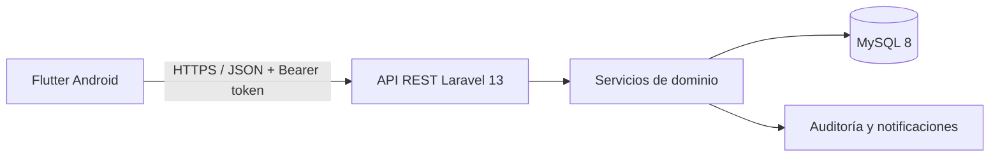

# AulaGestión

Aplicativo móvil para gestionar inventario, buscar, recomendar y reservar aulas de una institución educativa. El repositorio implementa los 12 requerimientos funcionales consolidados del proyecto académico mediante una arquitectura cliente-servidor.

## Entregables incluidos

- `mobile/`: aplicación Flutter con Material 3, navegación y permisos por rol.
- `backend/`: API REST Laravel 13 con Sanctum, validaciones, auditoría y MySQL.
- `docs/`: arquitectura, endpoints, manual de instalación, manual de usuario y matriz de trazabilidad.
- `postman/`: colección y entorno para probar la API.
- `docker-compose.yml`: MySQL y phpMyAdmin para desarrollo local.

## Arquitectura



## Requisitos

- Flutter estable 3.35 o superior y Android Studio.
- PHP 8.3 o superior y Composer 2.
- MySQL 8, o Docker Desktop para iniciar la base de datos.
- Git.

## Inicio rápido

### 1. Base de datos

Desde la raíz:

```bash
docker compose up -d
```

Esto inicia MySQL en `127.0.0.1:3307` y phpMyAdmin en `http://localhost:8081`.

### 2. API Laravel

```bash
cd backend
cp .env.example .env
composer install
php artisan key:generate
php artisan migrate --seed
php artisan serve --host=0.0.0.0 --port=8000
```

Comprueba la API en `http://127.0.0.1:8000/api/health`.

### 3. Aplicación Flutter

En otra terminal:

```bash
cd mobile
flutter create --platforms=android .
flutter pub get
flutter run --dart-define=API_BASE_URL=http://10.0.2.2:8000/api
```

El comando `flutter create` genera únicamente la carpeta nativa de Android correspondiente a la versión de Flutter instalada; el código profesional del aplicativo está en `lib/`.

`10.0.2.2` permite que el emulador Android acceda al servidor del computador. En un dispositivo físico, reemplázalo por la IP local del computador, por ejemplo `http://192.168.1.20:8000/api`.

## Usuarios de demostración

Los crea `DatabaseSeeder`; no corresponden a personas reales.

| Rol | Correo | Contraseña |
| --- | --- | --- |
| Administrador | `admin@demo.edu.co` | `Demo2026*` |
| Profesor | `profesor@demo.edu.co` | `Demo2026*` |
| Inventario | `inventario@demo.edu.co` | `Demo2026*` |

Cambie estas claves antes de desplegar el sistema.

## Pruebas

```bash
cd backend
php artisan test

cd ../mobile
flutter analyze
flutter test
```

## Personalización institucional

Modifique `mobile/lib/core/app_config.dart` para cambiar nombre, sigla, textos y datos de contacto. La paleta se encuentra en `mobile/lib/core/app_theme.dart`.

## Seguridad

- Contraseñas almacenadas con hash por Laravel.
- Tokens Sanctum guardados en almacenamiento seguro del dispositivo.
- Autorización por roles en servidor y cliente.
- Validación del servidor para todos los datos críticos.
- Transacciones y bloqueos para evitar reservas superpuestas.
- Registro de auditoría para reservas e inventario.
- No se incluyen secretos ni credenciales reales.

## Equipo Scrum

- María Alejandra Vallejo Zamora: Product Owner.
- Juan David Delgado Muñoz: Scrum Master e integración.
- Julián Andrés Ceballos Eraso: backend, datos y reglas de negocio.
- David Esteban Ortiz Ortiz: Flutter, interfaces y experiencia de usuario.

La guía completa está en `docs/GUIA_TECNICA_Y_USUARIO.md`.
