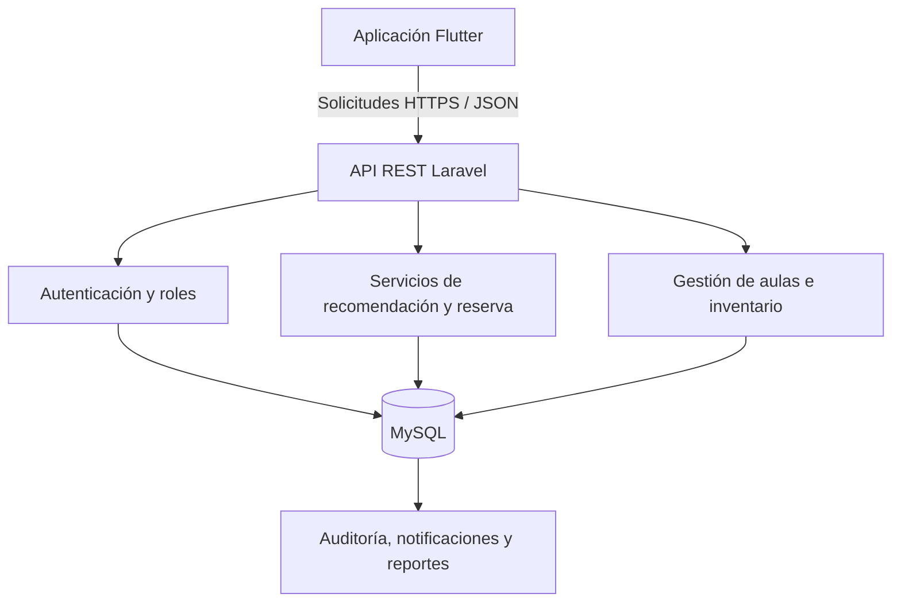
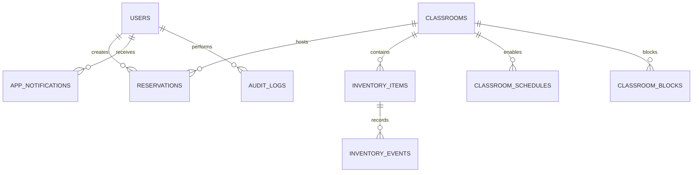
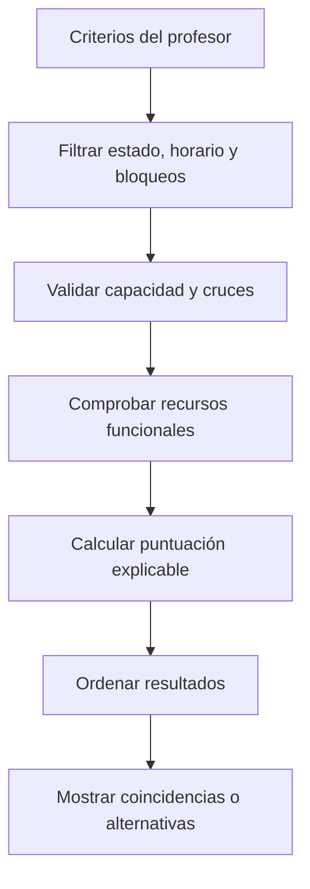

# AulaGestión

## Guía técnica, instalación, pruebas y manual de usuario

**Proyecto:** App Inventario Colegio  
**Versión:** 1.0.0  
**Arquitectura:** Flutter + API REST Laravel + MySQL  
**Propósito:** prototipo funcional para inventario, recomendación y reserva de aulas  

---

## 1. Resumen ejecutivo

AulaGestión centraliza la información de espacios académicos, recursos, horarios, bloqueos y reservas. Un profesor describe su actividad y el sistema recomienda aulas compatibles. La recomendación no es una selección aleatoria: filtra las aulas inválidas, calcula una puntuación y explica las razones de cada resultado.

El administrador gestiona usuarios, aulas, jornadas, bloqueos y reportes. El encargado de inventario actualiza recursos y registra novedades. El profesor busca, consulta, reserva y cancela conforme a las reglas institucionales.

La solución implementa los doce requerimientos funcionales consolidados y los criterios mínimos de aceptación entregados por el equipo.

## 2. Resultado entregado

| Componente | Contenido |
| --- | --- |
| Aplicación móvil | Flutter, Material 3, diseño adaptable, sesión segura, navegación y módulos por rol. |
| Servidor | Laravel 13, API REST JSON, Sanctum, validaciones, middleware de roles y servicios de dominio. |
| Persistencia | Migraciones MySQL, relaciones, índices, auditoría y datos iniciales. |
| Recomendación | Filtro por disponibilidad, capacidad, horario, bloqueos y recursos; puntuación y alternativas. |
| Calidad | Pruebas de autenticación, recomendación, conflictos de reserva y modelos del cliente. |
| Documentación | Guía de instalación, OpenAPI, Postman, manuales por rol y trazabilidad. |

## 3. Arquitectura de la solución



### Responsabilidades

- Flutter presenta la interfaz, valida los formularios, almacena el token de forma segura y consume la API.
- Laravel verifica identidad, permisos, integridad, reglas de negocio y concurrencia.
- MySQL conserva usuarios, aulas, inventario, novedades, horarios, bloqueos, reservas, avisos y auditoría.

La lógica crítica no depende de la interfaz. Aunque alguien intente llamar directamente a la API, el servidor vuelve a validar cada permiso y cada regla.

## 4. Modelo de datos



### Entidades principales

- `users`: identidad, correo, hash de contraseña, rol y estado.
- `classrooms`: código, nombre, ubicación, capacidad, tipo, estado y habilitación lógica.
- `inventory_items`: recurso, categoría, cantidad total, cantidad disponible y estado.
- `inventory_events`: daño, faltante, traslado, mantenimiento, recuperación o ajuste.
- `classroom_schedules`: jornada disponible por día y aula.
- `classroom_blocks`: franjas no reservables por evento o mantenimiento.
- `reservations`: profesor, aula, franja, asistentes, recursos, propósito y estado.
- `app_notifications`: confirmaciones, cancelaciones y alertas internas.
- `audit_logs`: usuario, acción, entidad, valores anteriores, valores nuevos, IP y fecha.

## 5. Reglas de negocio implementadas

1. Solo las cuentas activas pueden iniciar sesión.
2. Cada endpoint comprueba el rol autorizado.
3. Un aula inactiva, en mantenimiento o fuera de servicio no se puede reservar.
4. La capacidad debe ser igual o superior a la cantidad de asistentes.
5. La solicitud debe estar dentro de un horario institucional configurado.
6. Los bloqueos se excluyen de la disponibilidad.
7. Los recursos obligatorios deben existir, estar disponibles y tener cantidad mayor que cero.
8. Se aplica la condición de superposición correcta: `inicio_existente < final_solicitado` y `final_existente > inicio_solicitado`.
9. La reserva dura entre treinta minutos y ocho horas.
10. La disponibilidad se valida de nuevo al confirmar.
11. La confirmación se ejecuta dentro de una transacción con bloqueo de fila para reducir condiciones de carrera.
12. Solo el dueño de una reserva o el administrador puede cancelarla.
13. No se cancela una reserva que ya inició.
14. La cancelación exige un motivo y libera inmediatamente la franja.
15. Cada cambio crítico de aula, inventario, horario o reserva produce trazabilidad.

## 6. Cómo funciona el recomendador



La puntuación considera:

- disponibilidad completa de la franja;
- capacidad suficiente y cercanía entre capacidad y asistentes;
- cumplimiento de recursos obligatorios;
- presencia de recursos opcionales;
- afinidad entre tipo de aula y tipo de actividad.

Cada recomendación muestra el porcentaje, nivel de coincidencia y razones. Si no existe una coincidencia exacta, se presentan aulas cercanas con sus recursos faltantes y hasta tres franjas alternativas comprobadas.

## 7. Instalación paso a paso

### 7.1 Requisitos del computador

- Git.
- Docker Desktop, o MySQL 8 instalado manualmente.
- PHP 8.3 o superior.
- Composer 2.
- Flutter estable y Android Studio.
- Un emulador Android o un dispositivo físico con depuración USB.

Verifique:

```bash
git --version
php --version
composer --version
flutter doctor
docker --version
```

Corrija cualquier indicador rojo de `flutter doctor` antes de compilar Android.

### 7.2 Preparar MySQL

Abra una terminal en la carpeta `aula_gestion` y ejecute:

```bash
docker compose up -d
docker compose ps
```

Servicios disponibles:

- MySQL: `127.0.0.1:3307`.
- phpMyAdmin: `http://localhost:8081`.

El volumen `aula_mysql_data` conserva los datos aunque los contenedores se detengan.

### 7.3 Configurar Laravel

```bash
cd backend
cp .env.example .env
composer install
php artisan key:generate
php artisan migrate --seed
php artisan serve --host=0.0.0.0 --port=8000
```

En Windows PowerShell, reemplace el comando de copia por:

```powershell
Copy-Item .env.example .env
```

Compruebe en el navegador:

```text
http://127.0.0.1:8000/api/health
```

Debe aparecer `success: true`.

### 7.4 Configurar Flutter

Abra otra terminal:

```bash
cd mobile
flutter create --platforms=android .
flutter pub get
flutter analyze
```

El primer comando genera la carpeta Android compatible con la versión local del SDK y conserva el código de `lib/`.

### 7.5 Ejecutar en emulador Android

Inicie un emulador desde Android Studio y ejecute:

```bash
flutter run --dart-define=API_BASE_URL=http://10.0.2.2:8000/api
```

Android usa `10.0.2.2` para llegar al `localhost` del computador anfitrión.

### 7.6 Ejecutar en teléfono físico

1. Conecte el teléfono y el computador a la misma red Wi-Fi.
2. Consulte la IP local del computador; por ejemplo, `192.168.1.20`.
3. Permita el puerto 8000 en el firewall privado si es necesario.
4. Mantenga Laravel con `--host=0.0.0.0`.
5. Ejecute:

```bash
flutter run --dart-define=API_BASE_URL=http://192.168.1.20:8000/api
```

## 8. Datos para la demostración

El seeder crea tres usuarios ficticios:

| Rol | Correo | Contraseña |
| --- | --- | --- |
| Administrador | `admin@demo.edu.co` | `Demo2026*` |
| Profesor | `profesor@demo.edu.co` | `Demo2026*` |
| Inventario | `inventario@demo.edu.co` | `Demo2026*` |

También crea cinco aulas, inventario tecnológico, horarios de lunes a sábado, una reserva futura y notificaciones. Cambie estas claves antes de cualquier uso distinto de la demostración.

Para reiniciar completamente los datos:

```bash
php artisan migrate:fresh --seed
```

Este comando elimina y reconstruye las tablas. Úselo solo en desarrollo.

## 9. Manual del profesor

### Buscar y reservar

1. Inicie sesión como profesor.
2. Abra **Módulos** y seleccione **Buscar y reservar**.
3. Elija fecha, hora inicial y hora final.
4. Digite la cantidad de estudiantes y el tipo de actividad.
5. Marque los recursos obligatorios.
6. Marque recursos opcionales si desea mejorar la recomendación.
7. Pulse **Buscar mejores aulas**.
8. Revise porcentaje, capacidad, ubicación y razones.
9. Pulse **Reservar esta aula**.
10. Escriba un motivo de al menos cinco caracteres.
11. Confirme y conserve el número de reserva.

### Consultar o cancelar

1. Abra **Reservas**.
2. Alterne entre lista y calendario.
3. Filtre por confirmadas, canceladas o finalizadas.
4. En una reserva futura confirmada, pulse **Cancelar reserva**.
5. Registre el motivo y confirme.

La franja queda disponible después de una cancelación correcta.

## 10. Manual del encargado de inventario

### Registrar un elemento

1. Inicie sesión con rol de inventario.
2. Abra **Gestión de inventario**.
3. Pulse **Nuevo elemento**.
4. Seleccione aula, nombre, categoría, cantidad total, cantidad disponible y estado.
5. Guarde.

### Registrar una novedad

1. Ubique el elemento.
2. Pulse **Registrar novedad**.
3. Seleccione daño, faltante, traslado, mantenimiento, recuperación o ajuste.
4. Seleccione el nuevo estado.
5. Indique el cambio en unidades disponibles: negativo para descontar, positivo para recuperar.
6. Describa lo ocurrido y registre.
7. Consulte **Novedades e historial** para verificar usuario y fecha.

## 11. Manual del administrador

### Usuarios

- Registre nombre, correo, contraseña temporal, rol y estado.
- Actualice la información y cambie la contraseña solo si es necesario.
- Deshabilite cuentas sin eliminar su historial.

### Aulas

- Registre código único, nombre, ubicación, capacidad, tipo y estado.
- Use mantenimiento o fuera de servicio para impedir reservas.
- Deshabilite un aula cuando deba ocultarse conservando trazabilidad.

### Horarios y bloqueos

- Cree al menos una jornada para cada día reservable de cada aula.
- Registre bloqueos futuros por mantenimiento o evento.
- El sistema impide crear un bloqueo que afecte una reserva confirmada.

### Reportes

- Consulte usuarios y aulas activos.
- Revise reservas confirmadas del periodo.
- Compare las aulas con mayor uso.
- Identifique unidades disponibles, en mantenimiento, averiadas o fuera de servicio.

## 12. Matriz de trazabilidad

| Requisito | Backend | Aplicación móvil | Evidencia verificable |
| --- | --- | --- | --- |
| RF01 Autenticación y acceso | AuthController, Sanctum, EnsureRole | Login, sesión segura y menú por rol | Usuario activo accede; cuenta inválida se rechaza. |
| RF02 Usuarios y roles | UserController | UsersScreen | Crear, actualizar y deshabilitar. |
| RF03 Gestión de aulas | ClassroomController | ClassroomsScreen | CRUD lógico y detalle. |
| RF04 Inventario | InventoryController | InventoryScreen | Registrar y actualizar cantidades/estado. |
| RF05 Novedades | InventoryEvent, AuditLog | Formulario e historial | Usuario, fecha, tipo y descripción. |
| RF06 Horarios y bloqueos | ScheduleController | SchedulesScreen | Jornada por aula y bloqueos. |
| RF07 Disponibilidad | RecommendationService | SearchScreen | Excluye cruces, bloqueos e inhabilitadas. |
| RF08 Recomendación | Puntuación explicable | ResultsScreen | Orden, porcentaje y razones. |
| RF09 Detalle y alternativas | Aula con inventario y horarios alternos | Detalle y alternativas | Faltantes y franjas sugeridas. |
| RF10 Reservas | Transacción y revalidación | Confirmar/cancelar | Conflicto devuelve HTTP 409. |
| RF11 Calendario | Filtros por rango/estado | Lista y selector semanal | Reservas según permisos. |
| RF12 Avisos y reportes | Notifications y ReportController | Avisos y panel de reportes | Indicadores y estados. |

## 13. Endpoints principales

| Método | Ruta | Rol |
| --- | --- | --- |
| POST | `/api/auth/login` | Público |
| POST | `/api/auth/logout` | Autenticado |
| GET/POST | `/api/classrooms` | Consulta: todos; creación: admin |
| GET/POST/PUT | `/api/inventory` | Consulta: todos; cambios: inventario/admin |
| POST | `/api/inventory/{id}/events` | Inventario/admin |
| POST | `/api/recommendations/search` | Profesor/admin |
| GET/POST | `/api/reservations` | Profesor/admin |
| PATCH | `/api/reservations/{id}/cancel` | Dueño/admin |
| GET/POST | `/api/schedules` | Admin |
| GET/POST | `/api/blocks` | Admin |
| GET | `/api/notifications` | Autenticado |
| GET | `/api/reports/summary` | Admin/inventario |

La especificación detallada se encuentra en `docs/openapi.yaml`. La colección `postman/AulaGestion.postman_collection.json` permite ejecutar solicitudes manuales.

## 14. Pruebas

### Backend

```bash
cd backend
php artisan test
```

Casos incluidos:

- usuario activo recibe token y rol;
- usuario deshabilitado no inicia sesión;
- aula sin recurso obligatorio no aparece como coincidencia exacta;
- reserva superpuesta devuelve conflicto y no crea un segundo registro.

### Aplicación móvil

```bash
cd mobile
flutter analyze
flutter test
```

Las pruebas verifican la interpretación de aulas, inventario y recomendaciones JSON. Para la aceptación, recorra además la demostración de la sección siguiente.

## 15. Guion profesional para la sustentación

Duración sugerida: siete a diez minutos.

1. **Problema:** información dispersa, cruces y aulas sin recursos adecuados.
2. **Arquitectura:** muestre Flutter, API Laravel y MySQL como componentes separados.
3. **Roles:** inicie sesión brevemente con cada perfil y destaque el control de permisos.
4. **Flujo principal:** como profesor, solicite 25 estudiantes, videobeam obligatorio y televisor opcional.
5. **Explicabilidad:** señale el porcentaje y las razones de la recomendación.
6. **Integridad:** confirme la reserva y explique la revalidación transaccional.
7. **Trazabilidad:** registre una novedad de inventario y muestre el historial.
8. **Gestión:** abra reportes como administrador.
9. **Pruebas:** ejecute `php artisan test` y muestre los casos aprobados.
10. **Cierre:** mencione crecimiento futuro a sedes, QR y notificaciones push.

No presente el sistema como inteligencia artificial. Explique que la primera versión usa reglas transparentes, medibles y apropiadas para el alcance académico.

## 16. Personalización institucional

Edite `mobile/lib/core/app_config.dart`:

```dart
static const appName = 'AulaGestión';
static const institutionName = 'Nombre del colegio';
static const institutionShortName = 'Sigla';
static const supportEmail = 'soporte@colegio.edu.co';
```

La paleta institucional está en `mobile/lib/core/app_theme.dart`. Cambie `AppColors.navy`, `blue` y `teal` sin modificar los nombres para conservar la coherencia visual.

## 17. Flujo Git recomendado

```text
main       versión estable y demostrable
develop    integración del Sprint
feature/*  trabajo por requerimiento o historia
```

Ejemplos de commits:

```text
feat(auth): implementar acceso por roles
feat(reservas): validar cruces de horario
fix(inventario): limitar disponibles a cantidad total
test(recomendacion): excluir recursos no funcionales
docs(instalacion): agregar ejecución en teléfono físico
```

No publique `.env`, tokens, contraseñas reales, `vendor/`, `build/` ni archivos locales del IDE.

## 18. Solución de problemas

### La app muestra “No hay conexión con el servidor”

- Confirme que Laravel está ejecutándose.
- Abra `/api/health` desde el navegador.
- En emulador use `10.0.2.2`, no `127.0.0.1`.
- En teléfono use la IP local del computador.
- Revise firewall y que ambos equipos estén en la misma red.

### Laravel no conecta a MySQL

- Ejecute `docker compose ps`.
- Confirme puerto `3307` en `.env`.
- Compruebe base, usuario y contraseña contra `.env.example`.
- Limpie configuración: `php artisan config:clear`.

### No aparecen recomendaciones

- Verifique que la fecha sea de lunes a sábado.
- Confirme que el aula tenga horario para ese día.
- Revise estado, capacidad, bloqueos y reservas.
- Consulte el inventario y la cantidad disponible de cada recurso obligatorio.

### Flutter no compila Android

- Ejecute `flutter doctor`.
- Acepte licencias: `flutter doctor --android-licenses`.
- Regenere el soporte nativo: `flutter create --platforms=android .`.
- Ejecute `flutter clean` y luego `flutter pub get`.

## 19. Limitaciones y siguientes versiones

La versión 1.0 no incluye integración con el sistema académico, autenticación institucional externa, notificaciones push, QR, trabajo sin conexión, iOS ni predicción de demanda. La arquitectura permite agregarlos como nuevos módulos sin reescribir el núcleo de reservas.

Prioridades sugeridas:

1. publicación segura con HTTPS;
2. política configurable de anticipación y cancelación;
3. notificaciones push;
4. exportación de reportes a PDF/Excel;
5. códigos QR de ingreso;
6. múltiples sedes;
7. integración con calendario institucional.

## 20. Referencias técnicas

- Flutter: `https://docs.flutter.dev/install`
- Laravel 13: `https://laravel.com/docs/13.x`
- Laravel Sanctum: `https://laravel.com/docs/13.x/sanctum`
- MySQL 8: `https://dev.mysql.com/doc/`

---

**Conclusión:** AulaGestión entrega un producto mínimo viable coherente con el análisis académico, con separación de responsabilidades, seguridad por roles, integridad de reservas, recomendación explicable, trazabilidad y una interfaz preparada para una demostración profesional.
